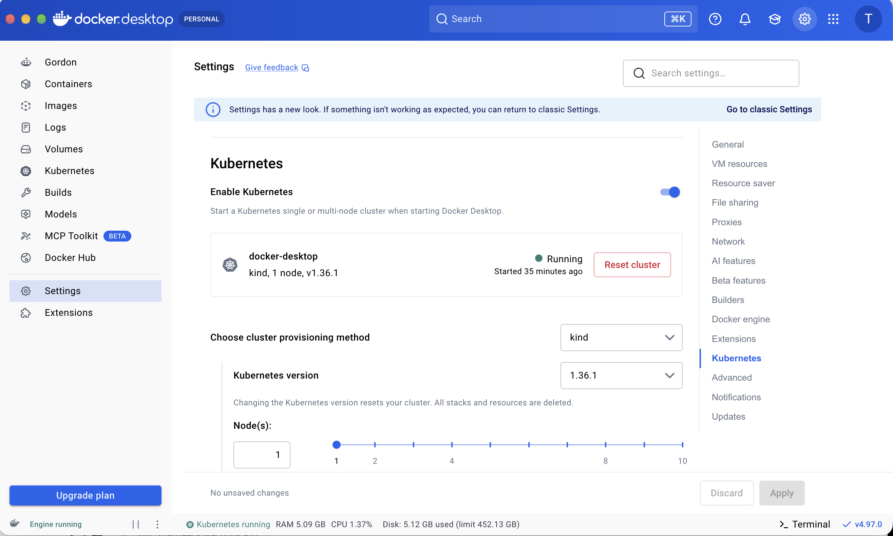
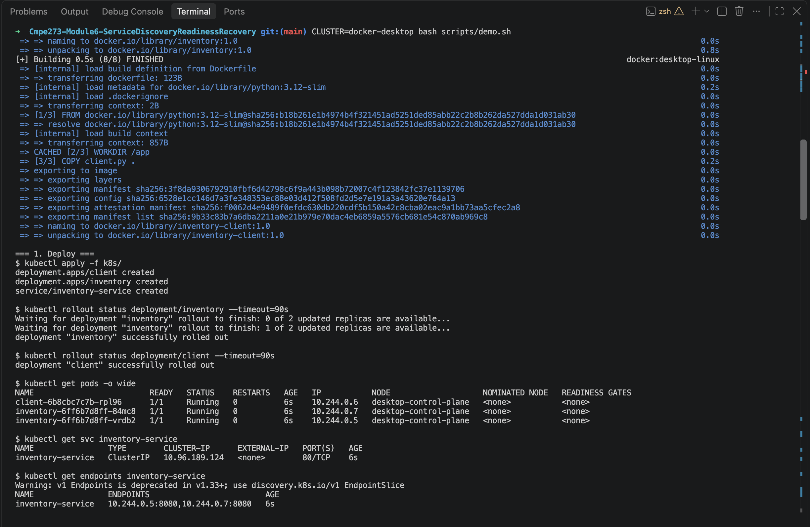
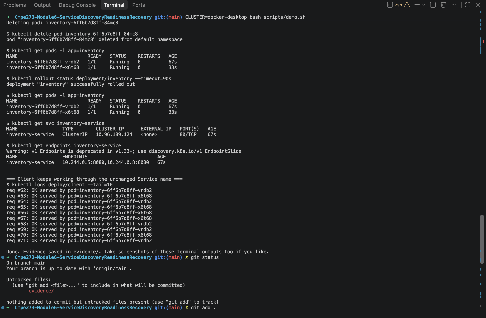

# Module 6: Service Discovery, Readiness & Recovery on Kubernetes

A small Inventory service (2 replicas) and a client that calls it **by Kubernetes Service name**, used to demonstrate service discovery, readiness probes, and Pod replacement.

Works on minikube, kind, or Docker Desktop Kubernetes.

## Repository layout

```
inventory/            Inventory app (Python stdlib HTTP server) + Dockerfile
client/               Client that calls http://inventory-service/items in a loop + Dockerfile
k8s/                  Deployment + Service manifests
scripts/demo.sh       Runs the whole demo and saves output to evidence/
evidence/             Terminal output captured by demo.sh
```

## Architecture

```
                 +--------------------------------------+
                 |            Kubernetes cluster         |
                 |                                      |
 +-----------+   |   DNS name        +-----------------+ |   +----------------------+
 |  client   |---|-> inventory-      | Service         |-|-->| inventory Pod #1     |
 | (1 Pod)   |   |   service:80      | inventory-      | |   | readiness: /ready    |
 +-----------+   |                   | service         | |   +----------------------+
                 |                   | (stable name +  | |   +----------------------+
                 |                   |  ClusterIP)     |-|-->| inventory Pod #2     |
                 |                   +-----------------+ |   | readiness: /ready    |
                 |   Only Pods that pass readiness        |   +----------------------+
                 |   are listed as Service endpoints      |
                 +--------------------------------------+
```

The Service selects Pods with label `app=inventory`. The client never uses Pod IPs; it uses the DNS name `inventory-service`.

## How it works

- `inventory/app.py` returns `{"pod": <pod name>, "items": [...]}` from `/items`, so every response shows which replica answered.
- `/ready` returns 200 normally and **503 if the file `/tmp/not-ready` exists**. This is how we make one Pod fail readiness without killing it.
- `/health` is a liveness endpoint that always returns 200.
- The Deployment's `readinessProbe` hits `/ready`; the Service only routes to Pods that are Ready.

## Deploying the application

Prerequisites: Docker, kubectl, and one of minikube / kind / Docker Desktop Kubernetes (running).

```bash
# 1. Build images
docker build -t inventory:1.0 inventory/
docker build -t inventory-client:1.0 client/

# 2. Make the images available to your cluster (pick ONE)
minikube image load inventory:1.0 && minikube image load inventory-client:1.0     # minikube
kind load docker-image inventory:1.0 inventory-client:1.0                          # kind
# Docker Desktop Kubernetes: nothing to do, it shares the local image store

# 3. Deploy
kubectl apply -f k8s/
kubectl rollout status deployment/inventory
kubectl get pods -o wide
kubectl get svc inventory-service

# 4. Watch the client talk to the Service name
kubectl logs -f deploy/client
```

To run every demo step below automatically and save the output:

```bash
CLUSTER=minikube ./scripts/demo.sh      # or kind / docker-desktop
```

## Demonstrations

All output below was captured on **Docker Desktop Kubernetes** (single node `desktop-control-plane`) by running `CLUSTER=docker-desktop ./scripts/demo.sh`. The raw output is saved in the `evidence/` folder.

### 1. Deployment, Service, and load across replicas

Commands:

```bash
kubectl get pods -o wide
kubectl get endpoints inventory-service
kubectl logs deploy/client --tail=12
```

What to look for: both Pods `Running` and `1/1 Ready`; the client log lines alternate between the two different `pod=` names, proving requests reach more than one replica through the Service name.

**What the output shows**

- Both Inventory Pods are `Running` and `1/1` Ready (`inventory-6ff6b7d8ff-84mc8` and `inventory-6ff6b7d8ff-vrdb2`).
- The Service `inventory-service` (ClusterIP `10.96.189.124`, port 80) lists **both** Pod IPs as endpoints: `10.244.0.5:8080,10.244.0.7:8080`.
- The client log shows responses from **both** replicas (`...84mc8` and `...vrdb2`), and each Pod's own server log shows `GET /items` requests coming from the client Pod (`10.244.0.6`). So requests reach more than one replica, through the Service name.
- The first 4 client requests failed with `Connection refused`. The client started at the same moment as the Inventory Pods, so the Service had no Ready endpoints yet. Once the Pods passed readiness, requests succeeded (req #5 onward), which is the readiness behavior working as intended.

<details>
<summary>Full terminal output (<code>evidence/1-deploy.txt</code>)</summary>

```text
=== 1. Deploy ===
$ kubectl apply -f k8s/
deployment.apps/client created
deployment.apps/inventory created
service/inventory-service created

$ kubectl rollout status deployment/inventory --timeout=90s
Waiting for deployment "inventory" rollout to finish: 0 of 2 updated replicas are available...
Waiting for deployment "inventory" rollout to finish: 1 of 2 updated replicas are available...
deployment "inventory" successfully rolled out

$ kubectl rollout status deployment/client --timeout=90s
deployment "client" successfully rolled out

$ kubectl get pods -o wide
NAME                         READY   STATUS    RESTARTS   AGE   IP           NODE                    NOMINATED NODE   READINESS GATES
client-6b8cbc7c7b-rpl96      1/1     Running   0          6s    10.244.0.6   desktop-control-plane   <none>           <none>
inventory-6ff6b7d8ff-84mc8   1/1     Running   0          6s    10.244.0.7   desktop-control-plane   <none>           <none>
inventory-6ff6b7d8ff-vrdb2   1/1     Running   0          6s    10.244.0.5   desktop-control-plane   <none>           <none>

$ kubectl get svc inventory-service
NAME                TYPE        CLUSTER-IP      EXTERNAL-IP   PORT(S)   AGE
inventory-service   ClusterIP   10.96.189.124   <none>        80/TCP    6s

$ kubectl get endpoints inventory-service
Warning: v1 Endpoints is deprecated in v1.33+; use discovery.k8s.io/v1 EndpointSlice
NAME                ENDPOINTS                         AGE
inventory-service   10.244.0.5:8080,10.244.0.7:8080   6s


=== Client logs: requests reaching MORE THAN ONE replica (via Service name) ===
$ kubectl logs deploy/client --tail=12
client starting, target = http://inventory-service:80/items
req #1: ERROR <urlopen error [Errno 111] Connection refused>
req #2: ERROR <urlopen error [Errno 111] Connection refused>
req #3: ERROR <urlopen error [Errno 111] Connection refused>
req #4: ERROR <urlopen error [Errno 111] Connection refused>
req #5: OK served by pod=inventory-6ff6b7d8ff-84mc8
req #6: OK served by pod=inventory-6ff6b7d8ff-84mc8
req #7: OK served by pod=inventory-6ff6b7d8ff-84mc8
req #8: OK served by pod=inventory-6ff6b7d8ff-84mc8
req #9: OK served by pod=inventory-6ff6b7d8ff-vrdb2
req #10: OK served by pod=inventory-6ff6b7d8ff-84mc8


=== Per-Pod server logs (both replicas receive requests) ===
--- pod/inventory-6ff6b7d8ff-84mc8
[inventory-6ff6b7d8ff-84mc8] 10.244.0.1 "GET /ready HTTP/1.1" 200 -
[inventory-6ff6b7d8ff-84mc8] 10.244.0.6 "GET /items HTTP/1.1" 200 -
[inventory-6ff6b7d8ff-84mc8] 10.244.0.1 "GET /health HTTP/1.1" 200 -
[inventory-6ff6b7d8ff-84mc8] 10.244.0.6 "GET /items HTTP/1.1" 200 -
[inventory-6ff6b7d8ff-84mc8] 10.244.0.1 "GET /ready HTTP/1.1" 200 -
--- pod/inventory-6ff6b7d8ff-vrdb2
[inventory-6ff6b7d8ff-vrdb2] 10.244.0.1 "GET /ready HTTP/1.1" 200 -
[inventory-6ff6b7d8ff-vrdb2] 10.244.0.6 "GET /items HTTP/1.1" 200 -
[inventory-6ff6b7d8ff-vrdb2] 10.244.0.1 "GET /health HTTP/1.1" 200 -
[inventory-6ff6b7d8ff-vrdb2] 10.244.0.1 "GET /ready HTTP/1.1" 200 -
[inventory-6ff6b7d8ff-vrdb2] 10.244.0.6 "GET /items HTTP/1.1" 200 -
```

</details>

### 2. Readiness failure and recovery

Make one Pod fail readiness (it stays running):

```bash
kubectl exec <inventory-pod> -- touch /tmp/not-ready
kubectl get pods -l app=inventory          # one shows 0/1 READY but STATUS Running
kubectl get endpoints inventory-service    # only the ready Pod's IP remains
kubectl logs deploy/client --tail=8        # all responses come from the ready Pod
```

Restore it:

```bash
kubectl exec <inventory-pod> -- rm /tmp/not-ready
kubectl get pods -l app=inventory          # back to 1/1 READY
kubectl logs deploy/client --tail=10       # both Pods serve again
```

Observed: the unready Pod is **still running**, it is **removed from the Service endpoints** and stops receiving normal traffic, and the **other Pod keeps serving**. After restoring, it rejoins the endpoints.

**What the output shows**

- After `touch /tmp/not-ready`, Pod `inventory-6ff6b7d8ff-84mc8` shows `0/1 Running`: it is **still running** but **not Ready**.
- The Service endpoints shrink to only the ready Pod: `10.244.0.5:8080`. The unready Pod was removed from the Service.
- Once the probe failure was registered, every client request was served by the other Pod (`...vrdb2`, requests #14 to #19). One response (#13) still came from the unready Pod; it fell inside the 3-second probe interval right after the flag was created, before the failed probe had been recorded.
- After `rm /tmp/not-ready`, the Pod returns to `1/1` Ready, both IPs are back in the endpoints, and the client logs show `...84mc8` serving traffic again (#26, #28 to #32).

<details>
<summary>Full terminal output (<code>evidence/2-readiness.txt</code>)</summary>

```text
=== 2. Readiness test ===
Pod chosen to fail readiness: inventory-6ff6b7d8ff-84mc8

$ kubectl exec inventory-6ff6b7d8ff-84mc8 -- touch /tmp/not-ready

$ kubectl get pods -l app=inventory
NAME                         READY   STATUS    RESTARTS   AGE
inventory-6ff6b7d8ff-84mc8   0/1     Running   0          20s
inventory-6ff6b7d8ff-vrdb2   1/1     Running   0          20s

$ kubectl get endpoints inventory-service
Warning: v1 Endpoints is deprecated in v1.33+; use discovery.k8s.io/v1 EndpointSlice
NAME                ENDPOINTS         AGE
inventory-service   10.244.0.5:8080   20s


=== Client logs now only show the READY pod ===
$ kubectl logs deploy/client --tail=8
req #12: OK served by pod=inventory-6ff6b7d8ff-vrdb2
req #13: OK served by pod=inventory-6ff6b7d8ff-84mc8
req #14: OK served by pod=inventory-6ff6b7d8ff-vrdb2
req #15: OK served by pod=inventory-6ff6b7d8ff-vrdb2
req #16: OK served by pod=inventory-6ff6b7d8ff-vrdb2
req #17: OK served by pod=inventory-6ff6b7d8ff-vrdb2
req #18: OK served by pod=inventory-6ff6b7d8ff-vrdb2
req #19: OK served by pod=inventory-6ff6b7d8ff-vrdb2


=== Restore readiness ===
$ kubectl exec inventory-6ff6b7d8ff-84mc8 -- rm /tmp/not-ready

$ kubectl get pods -l app=inventory
NAME                         READY   STATUS    RESTARTS   AGE
inventory-6ff6b7d8ff-84mc8   1/1     Running   0          28s
inventory-6ff6b7d8ff-vrdb2   1/1     Running   0          28s

$ kubectl get endpoints inventory-service
Warning: v1 Endpoints is deprecated in v1.33+; use discovery.k8s.io/v1 EndpointSlice
NAME                ENDPOINTS                         AGE
inventory-service   10.244.0.5:8080,10.244.0.7:8080   28s


=== Client logs: both pods serving again ===
$ kubectl logs deploy/client --tail=10
req #23: OK served by pod=inventory-6ff6b7d8ff-vrdb2
req #24: OK served by pod=inventory-6ff6b7d8ff-vrdb2
req #25: OK served by pod=inventory-6ff6b7d8ff-vrdb2
req #26: OK served by pod=inventory-6ff6b7d8ff-84mc8
req #27: OK served by pod=inventory-6ff6b7d8ff-vrdb2
req #28: OK served by pod=inventory-6ff6b7d8ff-84mc8
req #29: OK served by pod=inventory-6ff6b7d8ff-84mc8
req #30: OK served by pod=inventory-6ff6b7d8ff-84mc8
req #31: OK served by pod=inventory-6ff6b7d8ff-84mc8
req #32: OK served by pod=inventory-6ff6b7d8ff-84mc8
```

</details>

### 3. Pod deletion and replacement

```bash
kubectl get pods -l app=inventory
kubectl delete pod <inventory-pod>
kubectl get pods -l app=inventory          # a new Pod with a DIFFERENT name appears
kubectl get svc inventory-service          # same Service name and ClusterIP
kubectl logs deploy/client --tail=10       # client keeps working
```

Observed: the Deployment's ReplicaSet creates a replacement Pod with a new name/identity, the Service name (`inventory-service`) and ClusterIP are unchanged, and the client continues communicating through the Service without any configuration change.

**What the output shows**

- Deleted `inventory-6ff6b7d8ff-84mc8`. Kubernetes immediately created a replacement Pod, `inventory-6ff6b7d8ff-x6t68`, a **different name/identity** with a new IP (`10.244.0.8`, replacing `10.244.0.7`).
- The **Service name and ClusterIP are unchanged** (`inventory-service`, `10.96.189.124`); its endpoints updated automatically to `10.244.0.5:8080,10.244.0.8:8080`.
- The client was not touched or reconfigured and kept working: requests #62 to #71 were served by `...vrdb2` and the new `...x6t68` through the same Service name.

<details>
<summary>Full terminal output (<code>evidence/3-pod-recovery.txt</code>)</summary>

```text
=== 3. Pod failure and recovery ===
$ kubectl get pods -l app=inventory
NAME                         READY   STATUS    RESTARTS   AGE
inventory-6ff6b7d8ff-84mc8   1/1     Running   0          34s
inventory-6ff6b7d8ff-vrdb2   1/1     Running   0          34s

Deleting pod: inventory-6ff6b7d8ff-84mc8

$ kubectl delete pod inventory-6ff6b7d8ff-84mc8
pod "inventory-6ff6b7d8ff-84mc8" deleted from default namespace

$ kubectl get pods -l app=inventory
NAME                         READY   STATUS    RESTARTS   AGE
inventory-6ff6b7d8ff-vrdb2   1/1     Running   0          67s
inventory-6ff6b7d8ff-x6t68   1/1     Running   0          33s

$ kubectl rollout status deployment/inventory --timeout=90s
deployment "inventory" successfully rolled out

$ kubectl get pods -l app=inventory
NAME                         READY   STATUS    RESTARTS   AGE
inventory-6ff6b7d8ff-vrdb2   1/1     Running   0          67s
inventory-6ff6b7d8ff-x6t68   1/1     Running   0          33s

$ kubectl get svc inventory-service
NAME                TYPE        CLUSTER-IP      EXTERNAL-IP   PORT(S)   AGE
inventory-service   ClusterIP   10.96.189.124   <none>        80/TCP    67s

$ kubectl get endpoints inventory-service
Warning: v1 Endpoints is deprecated in v1.33+; use discovery.k8s.io/v1 EndpointSlice
NAME                ENDPOINTS                         AGE
inventory-service   10.244.0.5:8080,10.244.0.8:8080   67s


=== Client keeps working through the unchanged Service name ===
$ kubectl logs deploy/client --tail=10
req #62: OK served by pod=inventory-6ff6b7d8ff-vrdb2
req #63: OK served by pod=inventory-6ff6b7d8ff-x6t68
req #64: OK served by pod=inventory-6ff6b7d8ff-vrdb2
req #65: OK served by pod=inventory-6ff6b7d8ff-x6t68
req #66: OK served by pod=inventory-6ff6b7d8ff-x6t68
req #67: OK served by pod=inventory-6ff6b7d8ff-x6t68
req #68: OK served by pod=inventory-6ff6b7d8ff-vrdb2
req #69: OK served by pod=inventory-6ff6b7d8ff-vrdb2
req #70: OK served by pod=inventory-6ff6b7d8ff-x6t68
req #71: OK served by pod=inventory-6ff6b7d8ff-vrdb2
```

</details>

## Screenshots

**Docker Desktop: Kubernetes enabled and running (kind, 1 node, v1.36.1)**



**Locally built images `inventory:1.0` and `inventory-client:1.0`**


**`kubectl` context `docker-desktop`, node `Ready`, and the demo script building the images**


**1. Deploy: both Inventory Pods and the client Running, Service ClusterIP, and endpoints listing both Pod IPs**



**1. Client and per-Pod server logs showing both replicas receiving requests; 2. one Pod `0/1` (not Ready) and removed from the endpoints**


**2. Client traffic only on the ready Pod, readiness restored (both `1/1`, both endpoints), then both Pods serving again; start of Pod deletion**


**3. Pod deleted and replaced by a new Pod with a different name; Service name and ClusterIP unchanged; client keeps working**




## Reflection

<!-- Replace/edit with your own words before submitting. 3-5 sentences. -->

Pods are temporary: when one fails, is rescheduled, or is replaced, it gets a new name and a new IP address, so any client that hard-coded a Pod address would break. A Kubernetes Service gives the group of Pods one stable DNS name and virtual IP, and it automatically keeps its list of endpoints up to date based on labels and readiness. In this lab the client always called `inventory-service`, yet traffic moved away from the unready Pod and onto the replacement Pod without the client changing at all. This decouples clients from the lifecycle of individual Pods, which is what makes failures, rolling updates, and scaling invisible to callers.

## Cleanup

```bash
kubectl delete -f k8s/
```
